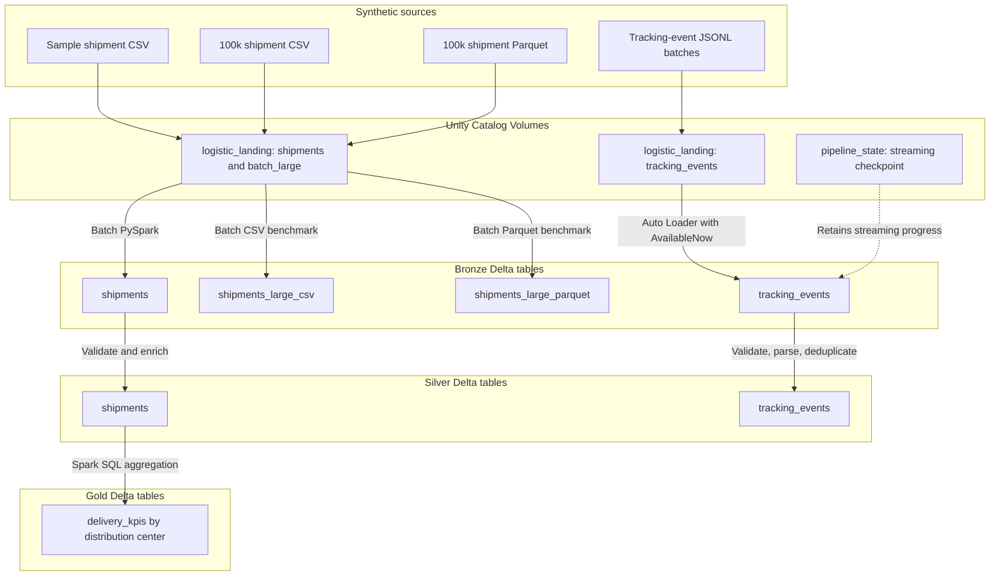

# Retail Logistics Lakehouse — Databricks

A hands-on data engineering portfolio project demonstrating **batch ingestion, incremental JSON file ingestion, Delta Lake, PySpark, Spark SQL, and Lakeflow Jobs** in **Databricks Free Edition**. The scenario simulates store replenishment shipments and shipment-tracking events across distribution centers.

> **Scope:** All data is synthetic. This is a learning and demonstration project, not a deployment for or an integration with any retailer. Azure Data Factory, ADLS Gen2, and production-grade CI/CD are possible extensions, **not currently implemented**.

## What has been implemented

| Workstream | Implementation | Verified result |
| --- | --- | --- |
| Shipment medallion pipeline | CSV → Bronze → Silver → Gold; three sequential notebook tasks in a Lakeflow Job | Job completed successfully; 5 source shipments and 2 distribution-center KPI rows |
| Large-file ingestion benchmark | Generate 100,000 shipments; convert CSV to Zstandard-compressed Parquet with Polars; ingest each into its own Bronze Delta table | 100,000 records in each input; first measured run: CSV **7.43 s**, Parquet **4.05 s** |
| Incremental tracking-event ingestion | JSON Lines → Auto Loader (`cloudFiles`) → Bronze Delta; persistent checkpoint and `AvailableNow` trigger | Two batches of 10,000 events; Bronze reached **20,000** records |
| Tracking-event quality | Bronze → Silver using PySpark validation, timestamp parsing and event-ID deduplication | Silver: **20,000** rows, **20,000** unique event IDs, **0** null timestamps |
| Tracking-event orchestration | Two-task Lakeflow Job with Bronze → Silver dependency | Manual job run **succeeded on 2026-11-09**, total duration **1 min 06 s** |

**Benchmark caveat:** The above times are a single measured run of read-and-write workflows, not isolated file-decoding benchmarks. Startup, caching, compute and Delta write overhead may influence results. The Parquet source file was **0.54 MiB** versus **5.02 MiB** for CSV (approximately **89.3% less storage**). See [benchmark notes](docs/ingestion_benchmarks.md).

## Data architecture



The **lakehouse** is not a separate app: it consists of governed data files in Unity Catalog Volumes, Delta tables in the Bronze/Silver/Gold schemas, and Spark workloads that process the data. Lakeflow Jobs orchestrate notebook execution.

### Storage and tables

| Purpose | Databricks object |
| --- | --- |
| Landing Volume | `workspace.bronze.logistic_landing` → `/Volumes/workspace/bronze/logistic_landing/` |
| Stream state Volume | `workspace.bronze.pipeline_state` → `/Volumes/workspace/bronze/pipeline_state/` |
| Raw shipments | `workspace.bronze.shipments` |
| Benchmark targets | `workspace.bronze.shipments_large_csv`, `workspace.bronze.shipments_large_parquet` |
| Raw tracking events | `workspace.bronze.tracking_events` |
| Validated shipments | `workspace.silver.shipments` |
| Validated tracking events | `workspace.silver.tracking_events` |
| Delivery KPIs | `workspace.gold.delivery_kpis` |

For implementation choices and design limitations, see [Architecture](docs/architecture.md).

## Processing and orchestration

**Shipment job — `retail-logistics-medallion-pipeline`:**

`01_ingest_bronze` → `02_transform_silver` → `03_build_gold`

This pipeline loads the original five-row shipment sample, checks shipment quantities/dates, classifies timeliness and fulfillment, then computes distribution-center delivery KPIs.

**Tracking job — `retail-logistics-json-streaming-pipeline`:**

`06_stream_tracking_events` → `07_transform_tracking_silver`

Auto Loader incrementally discovers new JSONL files in the landing Volume, appends events to Bronze and retains a checkpoint in `pipeline_state`. The downstream Silver notebook performs a **full refresh** from accumulated Bronze data, validates fields and deduplicates by `event_id`. The job is manually triggered in the confirmed demonstration; no recurring schedule is claimed.

**Important distinction:** Auto Loader is **file-based incremental streaming**, not a direct Kafka or API message stream. `AvailableNow` processes the files available at execution time and then stops. Checkpointing records processed files; it does **not** replace business-level deduplication of events that might appear in multiple source files.

## Reproduce the demo

1. Set up a Databricks workspace with Unity Catalog catalog `workspace` and schemas `bronze`, `silver` and `gold`.
2. Create managed Volumes `workspace.bronze.logistic_landing` and `workspace.bronze.pipeline_state`, subject to available permissions.
3. Upload `data/sample/shipments.csv` to the landing Volume, then run the shipment medallion notebooks sequentially or through their Lakeflow Job.
4. Generate the 100k shipment dataset and Parquet equivalent using the repository scripts and local environment; upload each format under `batch_large/csv/` and `batch_large/parquet/` and run the separate benchmark notebooks.
5. Generate two JSONL batches using `scripts/generate_tracking_events.py`. Upload `batch_001.json` into `tracking_events/`, execute the Auto Loader notebook, then upload `batch_002.json` and rerun the same notebook with the **same checkpoint**.
6. Run `07_transform_tracking_silver` or execute the two-task JSON Lakeflow Job. Verify the results with the SQL examples in [Runbook](docs/pipeline_runbook.md).

> Generated source files and checkpoint contents belong in local/Databricks data storage, **not Git**. Do not commit credentials, secrets, or real logistics records.

## Project structure

```text
retail-logistics-databricks/
├── README.md
├── data/sample/shipments.csv
├── scripts/
│   ├── generate_shipments.py
│   ├── convert_to_parquet.py
│   └── generate_tracking_events.py
├── notebooks/
│   ├── 01_ingest_bronze
│   ├── 02_transform_silver
│   ├── 03_build_gold
│   ├── 04_ingest_large_csv
│   ├── 05_ingest_large_parquet
│   ├── 06_stream_tracking_events
│   └── 07_transform_tracking_silver
└── docs/
    ├── ingestion_benchmarks.md
    ├── architecture.md
    └── pipeline_runbook.md
```

*Notebook file extensions vary by Databricks export format (`.py` / `.ipynb`). This tree is conceptual.*

## Technologies and skills demonstrated

- **Databricks Free Edition:** notebooks, Unity Catalog, Volumes, SQL Editor and serverless compute
- **Apache Spark / PySpark / Spark SQL:** schema definition, transformations, aggregations, window functions and validation
- **Delta Lake:** Bronze, Silver and Gold tables, append/overwrite writes
- **Auto Loader / Structured Streaming:** JSONL ingestion, checkpointing and `AvailableNow`
- **Lakeflow Jobs:** notebook dependencies and run monitoring
- **Python / Polars / uv:** synthetic data generation and Parquet conversion
- **Git / GitHub:** feature branches, commits, pull requests and documentation

## Limitations and possible next steps

This project is a controlled, small-scale learning implementation. The current Silver tracking transformation rereads the entire Bronze table and overwrites Silver; it is **not** an incremental Delta `MERGE`. Other production upgrades would include a dead-letter/rejected-record table, deterministic event versioning, schema evolution tests, automated data quality tests, infrastructure-as-code, deployment automation, alerts and external cloud storage integration.

## Documentation

- [Architecture and design decisions](docs/architecture.md)
- [Pipeline runbook and validation SQL](docs/pipeline_runbook.md)
- [CSV vs. Parquet benchmark](docs/ingestion_benchmarks.md)

## License

See [LICENSE](LICENSE).
