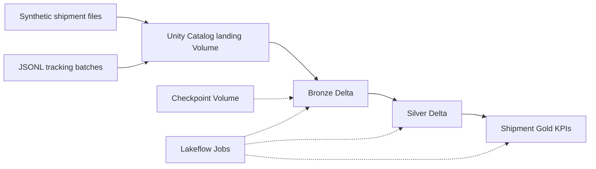

# Architecture and Design Decisions

## Goal and scope

Demonstrate how retail shipment and tracking data can be ingested, cleaned, and analyzed in a governed Databricks lakehouse. All datasets are synthetic. Actual Azure Data Factory, ADLS Gen2 ingestion and CI/CD deployment are **not implemented**.

## Logical architecture

The shipment and tracking branches are distinct: **only the shipment branch currently produces a Gold KPI table**. Benchmark tables are separate Bronze targets and do not feed the primary shipment Gold model.

## Databricks data objects

| Layer | Object | Purpose |
| --- | --- | --- |
| File landing | `/Volumes/workspace/bronze/logistic_landing/shipments.csv` | Five-row sample shipment feed |
| File landing | `/Volumes/workspace/bronze/logistic_landing/batch_large/csv/shipments_100k.csv` | Benchmark CSV source |
| File landing | `/Volumes/workspace/bronze/logistic_landing/batch_large/parquet/shipments_100k.parquet` | Benchmark Parquet source |
| File landing | `/Volumes/workspace/bronze/logistic_landing/tracking_events/` | New JSON Lines event files |
| State | `/Volumes/workspace/bronze/pipeline_state/tracking_events_checkpoint` | Structured Streaming progress and file discovery state |
| Bronze | `workspace.bronze.shipments` | Original batch feed |
| Bronze | `workspace.bronze.shipments_large_csv` | CSV benchmark output |
| Bronze | `workspace.bronze.shipments_large_parquet` | Parquet benchmark output |
| Bronze | `workspace.bronze.tracking_events` | Appended raw tracking-event records |
| Silver | `workspace.silver.shipments` | Validated delivery shipment data |
| Silver | `workspace.silver.tracking_events` | Validated and deduplicated tracking-event data |
| Gold | `workspace.gold.delivery_kpis` | Distribution-center shipment KPIs |

## Batch shipment branch

1. Notebook `01_ingest_bronze` reads CSV with an explicit schema and writes `workspace.bronze.shipments` as Delta, adding ingestion metadata.
2. `02_transform_silver` parses dates, rejects invalid quantity/date/key records, calculates delivery timeliness and fulfillment classifications, and writes `workspace.silver.shipments`.
3. `03_build_gold` uses Spark SQL to aggregate distribution-center KPIs into `workspace.gold.delivery_kpis`.
4. The Lakeflow Job `retail-logistics-medallion-pipeline` executes these notebooks in dependency order.

**Refresh semantics:** The original batch branch uses full-refresh overwrites. It is not a CDC pipeline.

## CSV vs. Parquet benchmark branch

A deterministic local generator creates 100,000 synthetic shipment rows. A Polars script converts CSV to Parquet using Zstandard compression. Databricks reads each input and writes to its **own** Delta Bronze table, avoiding interference with the original five-row demonstration.

| Metric | CSV | Parquet |
| --- | ---: | ---: |
| Source records | 100,000 | 100,000 |
| Source size | 5.02 MiB | 0.54 MiB |
| Initial read-and-write time | 7.43 s | 4.05 s |

Parquet was 89.3% smaller and the first measured ingestion execution was 45.5% shorter. **Do not generalize these single-run timings**: different cold/warm execution conditions, caching and Delta writes can influence the comparison.

## Incremental JSON tracking branch

1. `generate_tracking_events.py` produces two JSON Lines files, each with 10,000 events containing `event_id`, `shipment_id`, `event_timestamp`, `event_type`, `distribution_center` and `source_system`.
2. The files arrive in the landing directory on separate occasions.
3. `06_stream_tracking_events` uses `spark.readStream.format("cloudFiles")`, `cloudFiles.format=json`, an explicit schema and `trigger(availableNow=True)`.
4. Auto Loader appends newly discovered file records to `workspace.bronze.tracking_events` and saves progress to the checkpoint Volume.
5. `07_transform_tracking_silver` reads the accumulated Bronze table, parses ISO-8601 timestamps, checks required fields and accepted event types, rejects rescued data and keeps one record per `event_id` using a window ordered by ingestion time and tie-breakers.
6. The Lakeflow Job `retail-logistics-json-streaming-pipeline` executes the Bronze notebook, then the Silver notebook only after the first task succeeds.

**Verified observations:** first JSON file produced 10,000 records; after the second arrived, Bronze reached 20,000. The Silver validation query returned 20,000 total rows, 20,000 distinct event IDs and 0 null timestamps. The two-task job succeeded on 2026-11-09 (manual run, 1m 06s).

### Important semantics and trade-offs

- **Streaming here means incremental file ingestion**, not direct event consumption from Kafka/Event Hubs and not a continuously running stream. `AvailableNow` processes discovered files and terminates.
- **Checkpoint = file-processing state**, not a business-event uniqueness constraint. Two different source files could contain the same logical event ID; Silver handles event-ID deduplication.
- **Silver uses full refresh:** every Silver run reads Bronze and overwrites the cleaned result. This is simple for 20,000 rows but not scalable indefinitely.
- **Window-based deduplication:** the most recently ingested row for an event ID is preferred. Identical tie-breakers can still be nondeterministic. For production, include an upstream event version/sequence and a deterministic tie-breaker.
- **Invalid records:** the current Silver filter excludes invalid rows but does not persist a separate quarantine/dead-letter table. Adding one would improve observability.
- **Schema evolution:** rescued data can capture unexpected fields, but the demonstration does not claim to have completed a schema-evolution test.
- **Changing checkpoints:** deleting or replacing the checkpoint can cause historical files to be treated as new. Preserve checkpoint state and coordinate table resets with stream resets.

## What a production Azure deployment could add

An upstream API collector, ADF or other integration service could land data in ADLS Gen2. A governed external Volume or external location could replace the demo landing Volume. Further improvements include secrets management, workload identities, cluster/runtime controls, automatic testing, a schema contract, retries and alerts, production-grade event upserts, and data observability.

These are **proposed enhancements**, not features of the currently verified Free Edition project.
